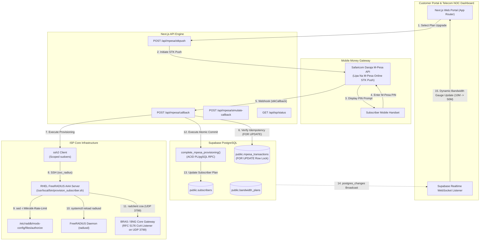

# Enterprise ISP Bandwidth Upgrade & FreeRADIUS Automated Provisioning Engine

[](https://nextjs.org/)
[](https://www.typescriptlang.org/)
[](https://tailwindcss.com/)
[](https://supabase.com/)
[](https://developer.safaricom.co.ke/)
[](https://freeradius.org/)
[](https://datatracker.ietf.org/doc/html/rfc5176)

An enterprise-grade ISP Self-Service Bandwidth Upgrade and Automated FreeRADIUS Provisioning Engine. When a fiber broadband subscriber initiates a bandwidth upgrade and pays via **Safaricom Daraja M-Pesa (STK Push)**, the backend verifies payment idempotency with ACID row locking in **Supabase PostgreSQL**, securely triggers an automated SSH command to a **Red Hat Enterprise Linux (RHEL) FreeRADIUS AAA server** to dynamically update the subscriber's rate-limit (`10M/10M` $\to$ `50M/50M`) and VLAN ID (`100` $\to$ `200`) via **RFC 5176 Change of Authorization (CoA)**, and streams the live provisioning telemetry to the customer portal using **Supabase Realtime** — all without disconnecting the active PPPoE session.

---

## Architecture & Data Flow



---

## Key Features

- **Automated M-Pesa Payment Pipeline:** Integrates Safaricom Daraja STK Push (Lipa Na M-Pesa Online) with automatic MSISDN normalization, Base64 credential generation, and sandbox fallback.
- **ACID Transaction Idempotency:** Implements a PostgreSQL `FOR UPDATE` lock and `complete_mpesa_provisioning()` PL/pgSQL RPC procedure. Replayed or duplicate webhooks are safely acknowledged without double-crediting or duplicate network re-provisioning.
- **Zero-Downtime Dynamic Provisioning (RFC 5176 CoA):** Changes bandwidth rate limits (`Mikrotik-Rate-Limit`) and VLAN tags (`Tunnel-Private-Group-Id`) on the fly using UDP port `3799` Change of Authorization packets, eliminating the need to tear down the subscriber's PPPoE/IPoE tunnel.
- **Anti-Injection Protection:** Strict regular expression verification on usernames (`^[a-zA-Z0-9_:-]+$`) and bandwidth specifications (`^[0-9]+[kKmMgG]/[0-9]+[kKmMgG]$`) before invoking any shell execution.
- **Real-Time Telecom NOC Dashboard:** High-contrast dark-mode operations center featuring animated SVG bandwidth speed gauges, session metrics, a 4-stage pipeline tracker, and live terminal log streaming.
- **Developer Simulation Lab:** Built-in simulation endpoint (`POST /api/mpesa/simulate-callback`) and one-click UI controls to simulate instant M-Pesa callbacks (both Success and User-Cancelled scenarios) and reset the subscriber state back to the base tier.
- **Dual-Mode Engine (Local Dry-Run vs Live VM):** `RADIUS_DRY_RUN="true"` runs a realistic local simulation with full timing and stdout emulation, while `RADIUS_DRY_RUN="false"` connects directly to a live RHEL FreeRADIUS server over SSH.

---

## Tech Stack

| Layer | Technologies |
| :--- | :--- |
| **Frontend** | Next.js 16 (App Router), React 19, TypeScript, Tailwind CSS v4, Lucide React, Framer Motion |
| **Backend API** | Next.js Dynamic Route Handlers, Zod schema validation |
| **Database & Realtime** | Supabase (`@supabase/supabase-js`), PostgreSQL 15, Row Level Security (RLS), Supabase Realtime |
| **Network Provisioning** | `ssh2` Client, RHEL 8/9 FreeRADIUS 3.x, `radclient` (RFC 5176 CoA UDP 3799), Bash |
| **Billing & Payments** | Safaricom Daraja 2.0 API (OAuth, STK Push, Callback Webhooks) |

---

## Project Structure

```text
ispbillingradius/
├── .env.example                       # Environment configuration template
├── .env.local                         # Local environment variables
├── package.json                       # Dependencies & scripts
├── tsconfig.json                      # TypeScript configuration
├── next.config.ts                     # Next.js configuration
├── scripts/
│   └── provision_subscriber.sh        # RHEL FreeRADIUS & RFC 5176 CoA bash script
├── supabase/
│   └── migrations/
│       └── 001_init_isp_engine.sql    # Schema, RLS, Realtime publication, and ACID RPC
└── src/
    ├── app/
    │   ├── layout.tsx                 # Root layout & dark-mode styling
    │   ├── page.tsx                   # Telecom NOC Dashboard & Customer Portal
    │   ├── globals.css                # Global styles, scanline, & terminal glow
    │   └── api/
    │       ├── isp/
    │       │   ├── status/route.ts    # Telemetry, plans, & audit log polling
    │       │   └── reset/route.ts     # Demo reset to 10M base plan
    │       └── mpesa/
    │           ├── stkpush/route.ts   # STK Push dispatch & initial ledger insert
    │           ├── callback/route.ts  # Safaricom webhook, idempotency, & CoA trigger
    │           └── simulate-callback/route.ts # Developer simulation endpoint
    └── lib/
        ├── supabase.ts                # Supabase browser & admin clients + types
        ├── daraja.ts                  # Safaricom Daraja OAuth & STK Push client
        ├── radius-ssh.ts              # SSH client & dry-run CoA simulator
        └── store.ts                   # In-memory synchronized fallback store
```

---

## Getting Started

### 1. Prerequisites
- Node.js 18.x or 20.x
- npm, yarn, or pnpm
- (Optional for live mode) Red Hat Enterprise Linux (RHEL 8/9) with FreeRADIUS installed

### 2. Installation
Clone the repository and install dependencies:
```bash
git clone <repository-url>
cd ispbillingradius
npm install
```

### 3. Environment Configuration
Copy `.env.example` to `.env.local`:
```bash
cp .env.example .env.local
```

Configure your environment variables:
```ini
# Supabase Configuration
NEXT_PUBLIC_SUPABASE_URL="https://your-project.supabase.co"
NEXT_PUBLIC_SUPABASE_ANON_KEY="eyJhbGciOiJIUzI1NiIsInR5cCI6IkpXVCJ9..."
SUPABASE_SERVICE_ROLE_KEY="eyJhbGciOiJIUzI1NiIsInR5cCI6IkpXVCJ9..."

# FreeRADIUS & Network Provisioning
RADIUS_DRY_RUN="true"                  # Set to "false" when deploying to a live RHEL VM
RHEL_RADIUS_HOST="192.168.10.25"
RHEL_RADIUS_PORT="22"
RHEL_RADIUS_USER="svc_radius"
RHEL_RADIUS_SSH_KEY=""
RHEL_RADIUS_PASSWORD=""
RADIUS_NAS_IP="10.10.10.1"
RADIUS_NAS_SECRET="testing123"

# Safaricom Daraja M-Pesa Configuration (Sandbox)
DARAJA_ENV="sandbox"
DARAJA_CONSUMER_KEY="your_consumer_key"
DARAJA_CONSUMER_SECRET="your_consumer_secret"
DARAJA_SHORTCODE="174379"
DARAJA_PASSKEY="bfb279f9aa9bdbcf158e97dd71a467cd2e0c893059b10f78e6b72ada1ed2c919"
DARAJA_CALLBACK_URL="http://localhost:3000/api/mpesa/callback"
```

> **Note:** With `RADIUS_DRY_RUN="true"`, the entire application runs locally out of the box with zero external dependencies required.

### 4. Running the Application
Start the development server:
```bash
npm run dev
```

Open [http://localhost:3000](http://localhost:3000) in your browser.

Build for production:
```bash
npm run build
npm start
```

---

## Testing & Verification Walkthrough

You can test the entire upgrade pipeline directly through the browser UI or via the API:

### Method A: Via the Web Dashboard (Recommended)
1. Open [http://localhost:3000](http://localhost:3000).
2. The active subscriber `cust_001` starts at **10M/10M (VLAN 100)**.
3. Click **Upgrade with M-Pesa** on the **Business Fiber 50 Mbps** card.
4. In the modal, confirm the phone number (`254712345678`) and click **Authorize KES 4,500**.
5. The transaction enters `PENDING` state and appears in the Real-Time Provisioning Console.
6. Click **Simulate Success** in the Developer Simulation Lab.
7. Observe the 4 pipeline stages turn green:
   - `[1] STK Push Dispatched`
   - `[2] Webhook & Idempotency Lock`
   - `[3] SSH & FreeRADIUS CoA`
   - `[4] Supabase RPC Ledger Committed`
8. The bandwidth gauge dynamically animates to **50 Mbps**, and the VLAN tag switches to **VLAN 200**.
9. Click **Reset Demo (10M)** in the top navigation to revert and test again.

### Method B: Via CLI (cURL / PowerShell)
1. **Initiate an STK Push:**
   ```bash
   curl -X POST http://localhost:3000/api/mpesa/stkpush \
     -H "Content-Type: application/json" \
     -d '{"subscriberId":"99999999-9999-9999-9999-999999999999","targetPlanId":"22222222-2222-2222-2222-222222222222","phoneNumber":"254712345678"}'
   ```
2. **Simulate Daraja Payment Confirmation:**
   ```bash
   curl -X POST http://localhost:3000/api/mpesa/simulate-callback \
     -H "Content-Type: application/json" \
     -d '{"checkoutRequestId":"<CHECKOUT_REQUEST_ID_FROM_STEP_1>","amount":4500,"resultCode":0}'
   ```
3. **Verify Idempotent Replay Protection:**
   Re-send the command from Step 2 with the same `checkoutRequestId`. The response will immediately return:
   ```json
   {
     "ResultCode": 0,
     "ResultDesc": "Already provisioned (Idempotent acknowledgment)"
   }
   ```
4. **Check Subscriber Telemetry:**
   ```bash
   curl http://localhost:3000/api/isp/status
   ```

---

## Production Deployment to RHEL FreeRADIUS Host

When connecting to a real Red Hat Enterprise Linux 8/9 FreeRADIUS server:

1. **Copy the script to the RHEL VM:**
   ```bash
   scp scripts/provision_subscriber.sh svc_radius@<RHEL_IP>:/tmp/
   ```

2. **Log into the server and move to `/usr/local/bin`:**
   ```bash
   ssh svc_radius@<RHEL_IP>
   sudo mv /tmp/provision_subscriber.sh /usr/local/bin/provision_subscriber.sh
   sudo chmod 750 /usr/local/bin/provision_subscriber.sh
   sudo chown root:svc_radius /usr/local/bin/provision_subscriber.sh
   ```

3. **Grant scoped sudoers permissions (no password required for `svc_radius`):**
   ```bash
   echo "svc_radius ALL=(root) NOPASSWD: /usr/local/bin/provision_subscriber.sh" | sudo tee /etc/sudoers.d/radius_provisioning
   sudo chmod 440 /etc/sudoers.d/radius_provisioning
   ```

4. **Install FreeRADIUS utilities (for `radclient`):**
   ```bash
   sudo dnf install -y freeradius-utils
   sudo mkdir -p /var/log/radius
   ```

5. **Update `.env.local` on the Next.js server:**
   ```ini
   RADIUS_DRY_RUN="false"
   RHEL_RADIUS_HOST="<RHEL_IP>"
   RHEL_RADIUS_USER="svc_radius"
   RHEL_RADIUS_SSH_KEY="<PATH_OR_PEM_KEY>"
   RADIUS_NAS_IP="<BNG_ROUTER_IP>"
   RADIUS_NAS_SECRET="<RADIUS_SECRET>"
   ```

---

## Database Migration (Supabase)

If setting up a fresh Supabase database:
1. Open the **SQL Editor** in your Supabase Dashboard.
2. Copy the contents of [`supabase/migrations/001_init_isp_engine.sql`](file:///c:/Users/Admin/Desktop/ispbillingradius/supabase/migrations/001_init_isp_engine.sql).
3. Run the script. It will create:
   - Tables: `bandwidth_plans`, `subscribers`, `mpesa_transactions`
   - Realtime publication bindings
   - RLS policies
   - Stored Procedure: `complete_mpesa_provisioning()`
   - Seed data for 10M, 50M, and 100M tiers, plus subscriber `cust_001`

---

## License

This project is licensed under the MIT License.
